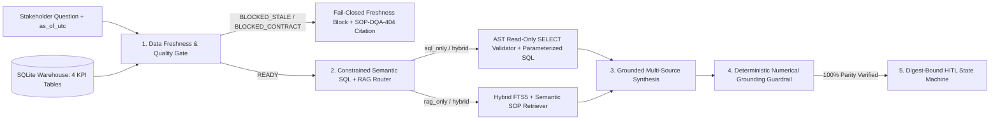

# Principal-Level Architecture Deep Dive — Enterprise Hybrid Data Copilot

## 1. The Enterprise Problem: Why Text-to-SQL and Document RAG Fail in Isolation
In industrial, healthcare, and enterprise operations, stakeholder questions rarely live in a single data modality:
- A question like *"Which zone triggered the FIN-CAP-8PCT CFO Discretionary Spend Freeze in 2026-Q3 based on its OPEX variance percentage?"* requires **two distinct sources of truth**:
  1. **Structured Relational Warehouse (`zone_financial_kpis`)**: Live quarterly numbers (`Zone_US_East_Robotics` `opex_variance_pct = 14.0%`, `Zone_EMEA_Imaging` `opex_variance_pct = 4.5%`).
  2. **Unstructured Governance SOP (`SOP-FIN-202#S1`)**: The policy rule defining that `> 8.0%` triggers a mandatory CFO Discretionary Spend Freeze while `3.0%–8.0%` requires a VP Finance variance memo.

Furthermore, executing analytics without **pre-query data quality gating** exposes executives to silent data corruption when an upstream ETL pipeline stalls (e.g., `legacy_supply_backlog_partition` stuck at `222.0` hours old).

---

## 2. End-to-End System Architecture

---

## 3. Four Core Engineering Pillars

### Pillar 1: Pre-Query Data Freshness & Schema Contract Gate (`src/copilot/data_quality.py`)
Before any SQL query is planned or executed, `inspect_single_table()` validates each target table against its `TableContract`:
1. **Schema Contract**: Verifies all `required_columns` via `PRAGMA table_info(table)`.
2. **Volume Bounds**: Verifies `min_rows <= row_count <= max_rows`.
3. **Null-Ratio Ceiling (`DQA-NULL-5PCT`)**: Computes per-column null ratio $\frac{\text{nulls}(c)}{N} \le 0.05$.
4. **Refresh Timestamp SLA (`DQA-FRESH-24H`)**:
   $$\Delta t_{\text{hours}} = \frac{t_{\text{as\_of\_utc}} - \max_i(t_{\text{refreshed\_at\_utc}, i})}{3600}$$
   If $\Delta t_{\text{hours}} > \text{max\_staleness\_hours}$, the table is marked `blocked_stale` and any query targeting it is rejected before SQL execution (`Freshness_Gate_Precision = 1.0000`).

### Pillar 2: AST-Validated Parameterized Semantic SQL (`src/copilot/router.py`)
Giving an LLM raw write-capable database credentials or executing unconstrained free-text SQL risks SQL injection, accidental mutations, and schema hallucinations. Under policy `SQL-AST-RO`, `validate_sql_ast_read_only()` enforces:
- Zero SQL comments (`--` or `/* */`) and zero multi-statement semicolons (`;`).
- Root statement must be `SELECT`.
- Zero mutating or administrative keywords (`INSERT`, `UPDATE`, `DELETE`, `DROP`, `ALTER`, `ATTACH`, `PRAGMA`, `VACUUM`).
- All `FROM` and `JOIN` targets must belong to `ALLOWED_WAREHOUSE_TABLES`, and parameters bind exclusively via `:param` placeholders.

### Pillar 3: Deterministic Numerical Grounding Guardrail (`src/copilot/verifier.py`)
Under control `NUM-PARITY-100`, `verify_numerical_grounding()` scrubs identifier codes (`2026-Q3`, `OPS-SLA-95`, `VND-LOG-03`) and extracts every numeric, currency (`EUR`), and percentage (`%`) token $\hat{y}_k$ from the drafted summary. Every $\hat{y}_k$ is matched against the union of exact SQL result cells and retrieved SOP passage numbers:
$$\min_{y \in \mathcal{Y}_{\text{SQL}} \cup \mathcal{Y}_{\text{SOP}}} \frac{|\hat{y}_k - y|}{\max(|y|, 1)} \le 10^{-2}$$
If any number is unverified (`numerical_parity_rate < 1.0`), the guardrail blocks workflow approval.

### Pillar 4: Cryptographic Digest-Bound HITL State Machine (`src/copilot/workflow.py`)
Executive decision briefs follow a strict 4-state lifecycle (`DRAFT -> PENDING_APPROVAL -> APPROVED / REJECTED`) in SQLite (`hitl_workflows`). Every transition is bound to:
$$\text{composite\_evidence\_sha256} = \text{SHA-256}\Big(\text{norm}(q) \;\|\; \text{SHA-256}(\text{SQL\_snapshot}) \;\|\; \text{sort}\big(\{p_i : \text{SHA-256}(p_i)\}\big) \;\|\; \text{SHA-256}(\text{answer})\Big)$$
When `verify_digest()` runs after a warehouse table refresh or policy update, any change to the SQL snapshot hash automatically transitions an `APPROVED` record to `REJECTED` with audit note `invalidated_by_data_drift`.
